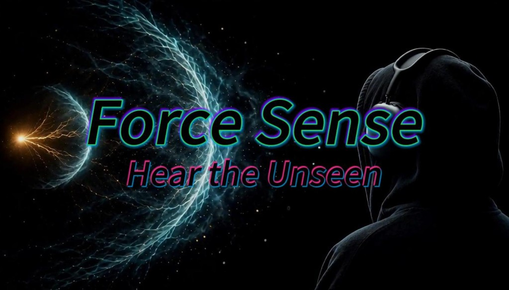

# Hear the Unseen



Mac camera and IMU tracking for a Unity game you play by ear. The game is [`HearTheUnseen-unity-game/`](HearTheUnseen-unity-game/README.md). This repository also runs the tracker that Unity consumes.

```text
Mac camera → Face Landmarker → head pose
Mac camera → Pose Landmarker wrist + IMU coast → saber handle
Arduino IMU → blade orientation
Python pose → UDP 8766 → Unity
```

## Demo

A Mac camera tracks the head and the wrist. The IMU in the hilt sets the blade. Unity plays that pose as a saber in a training chamber.

The blade on screen matches the hilt in your hand.

https://github.com/user-attachments/assets/aa0d9403-dc4c-4b98-9943-3e06c8fc3940

Shots come from around the head and fly at the chest. Block with the blade. Headphones carry which way each shot is coming from.

https://github.com/user-attachments/assets/4dbcd39b-8b8e-4320-a9a4-7a1c269fe8b0

## Layout

- `python-backend/tracker/` — process that wires the camera, vision, IMU, and pose UDP. `./run.zsh` starts it on macOS, and `run.ps1` on Windows. The other Python packages (`mac_camera`, `vision_pose`, `imu_attitude`, `imu_transport`, `inertial_coast`, `pose_protocol`) are libraries that process calls. The map is [`ARCHITECTURE.md`](ARCHITECTURE.md).
- `web/tracker-page/` — local tracker page: headphone listener, camera preview, and calibration.
- `HearTheUnseen-unity-game/Assets/HearTheUnseen/` — the game. `HearTheUnseen-unity-game/Assets/PoseLink/` reads pose. `HearTheUnseen-unity-game/Assets/BinauralHead/` is the Steam Audio listener. Steam Audio is fetched by `HearTheUnseen-unity-game/fetch-steam-audio.zsh`, not stored in git.
- `firmware/saber-board/HearTheUnseen/` — Uno firmware (MPU6500-compatible six-axis board and optional QMC5883P).
- `phone/touchosc/` — optional iPhone layout. `phone/generate_touchosc.py` rebuilds it from `HearTheUnseen.lua`.
- `assets/` — MediaPipe models downloaded by `run.zsh`.
- `docs/` — cover and demo clips.
- `THIRD_PARTY.md` — where each third-party file comes from.

## Run

Use wired headphones. macOS:

```zsh
chmod +x run.zsh
./run.zsh
```

Windows, from the repo root:

```powershell
powershell -ExecutionPolicy Bypass -File .\run.ps1
```

Both scripts take the same arguments. The first run creates `.venv`, installs the Python packages, and downloads the Face and Pose Landmarker models (`float16/1`, checksummed). Later runs reuse them. The saber IMU is the Arduino on the only USB serial port (`--serial auto`; `COMx` on Windows). Open [http://127.0.0.1:8765](http://127.0.0.1:8765) in Chrome or Safari. The system may ask for Camera access; allow it for Terminal or Python. If the browser asks to start audio, click **Start audio**.

To open the Unity game, fetch Steam Audio once, then open `HearTheUnseen-unity-game/` in Unity Hub. See [`HearTheUnseen-unity-game/README.md`](HearTheUnseen-unity-game/README.md).

The server prefers the built-in camera by name each launch (FaceTime / Built-in / MacBook, or Integrated Camera on Windows) and skips Continuity Camera, iPhone, Desk View, and virtual cameras. Override with `--camera MacBook` or `--camera Integrated`, or list cameras with `--list-cameras`. Do not use the iPhone as Continuity Camera while it is the saber IMU. It asks for 640×480 at 60 fps. The terminal prints the mode the camera actually opened.

For a head-only run, disable wrist inference:

```zsh
./run.zsh --pose-fps 0 --preview-fps 2
```

## Tracker page

1. Face the camera and click **Set forward** (or press `C`). Keep still for two seconds.
2. **Mirror display + audio** mirrors the preview and the headphone left/right. World is a room view from behind you, looking at the Mac.
3. Sit so the camera sees your shoulders and the holding hand. Point the blade toward the camera, then click **Set saber reference** and keep still for two seconds.

The camera panel draws face and pose overlays on the frame already captured for tracking. It is not a second camera and it is not on the audio path.

## Arduino IMU

The tracker opens the only USB serial port at 230400 baud. Reflash `firmware/saber-board/HearTheUnseen` before running; a board still on 115200 produces no IMU samples. Pass `--serial /dev/cu.usbmodem3101` or `--serial COM3` when more than one is plugged in. SDA is A4, SCL is A5, vibration IN is D9, and the direction button is D2 to GND. Firmware streams six-axis `IMU` frames and, when a QMC5883P is present, separate `MAG` frames. A missing magnetometer does not stop six-axis streaming.

Calibrate once with the wires fixed: hold still, pause on each of the six faces, then tumble slowly away from metal. The fit is saved under `.cache/` and reused. Until that file exists, fusion keeps an approximate +8° mount. `--mag-mount-angle DEGREES` overrides it. `--no-magnetometer` keeps raw magnetic readings but disables heading correction. `--mag-declination DEGREES` (east positive) enables true heading; without it, true heading stays empty.

The hardware button locks direction immediately. **Set forward**, **Set saber reference**, and the same Unity controls keep the saber still for two seconds, then set direction.

## iPhone instead of Arduino

```zsh
./run.zsh --iphone
```

This does not open a serial port. In ZIG SIM use UDP OSC to the printed Host IP, port `8000`, and enable GYRO, QUATERNION, and GRAVITY. TouchOSC can also send that pose and receive `/vibrate` on port `9000`; the layout is `phone/touchosc/HearTheUnseen.tosc`.

## Scope

- Yaw uses an approximate webcam field of view.
- Face tracking is meant for roughly ±60° yaw, and it is not a final solution for a fully opaque blindfold.
- The tracker page listens on `127.0.0.1`. With `--iphone`, IMU uses LAN UDP port 8000. Camera frames stay on the Mac.
- The page hum is generated in the browser. Game audio lives in the Unity project.

## License

The code in this repository is [MIT](LICENSE). MediaPipe, Steam Audio, and the art and audio packs keep the licenses listed in [`THIRD_PARTY.md`](THIRD_PARTY.md).
